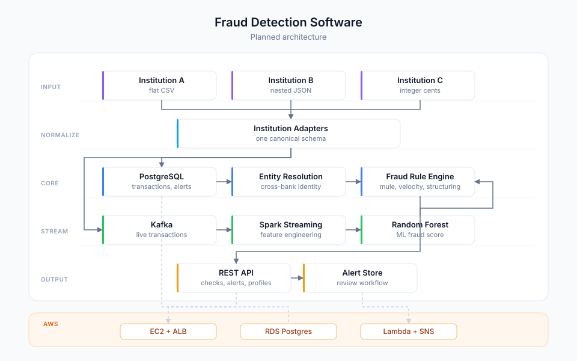

# Fraud Detection Software (in progress)

Personal project: a multi-institution fraud detection platform. Simulated banks send transactions in different formats. A shared service normalizes them, resolves identities across institutions, detects fraud with rules and ML, scores live transactions, and deploys to AWS.

## Where I'm at

Phase 1 in progress. Spring Boot + PostgreSQL are running. Core entities (Institution, Account, Transaction, Alert, EntityMatch) and institution adapters exist. Docker Compose handles local setup with profiles for local, docker, and aws. Still to do: Flyway migrations, data generator, remaining adapters.

## Architecture

## Roadmap

**Phase 1 — Core data model**
Canonical schema, Flyway migrations, YAML-driven data generator with injected fraud patterns (muling, structuring, velocity), institution adapters for 3–5 banks, Testcontainers against Postgres.
Spring Boot, JPA, PostgreSQL, Flyway, Datafaker, Docker.

**Phase 2 — Fraud detection**
Entity resolution (Levenshtein matching, DOB/tax ID signals, blocking buckets), configurable rule engine (money mule, high-value cross-institution transfer, structuring/velocity), REST API for fraud checks, alerts, and entity profiles.
Apache Commons Text, springdoc-openapi, JUnit 5, Mockito.

**Phase 3 — Batch ML + streaming**
Separate Spark module: batch feature engineering, Random Forest classifier with class imbalance handling, Kafka live feed, Structured Streaming for real-time scoring tied back to the rule engine.
Spark 3.5.x, MLlib, Kafka, JDBC, Parquet.

**Phase 4 — AWS via Terraform**
Modular VPC, EC2 + ALB, RDS in private subnets, Secrets Manager for credentials, Lambda + SNS for alert notifications, least-privilege security groups.
Terraform, EC2, RDS, Lambda, SNS, SES, S3, DynamoDB.

**Phase 5 — Containers, CI/CD, tests**
Multi-stage Docker, docker-compose with Kafka, GitHub Actions (OIDC to ECR/EC2), unit tests for rule boundaries, integration tests with Testcontainers, Spring Cloud Contract.
Docker, GitHub Actions, Testcontainers, Spring Cloud Contract.
